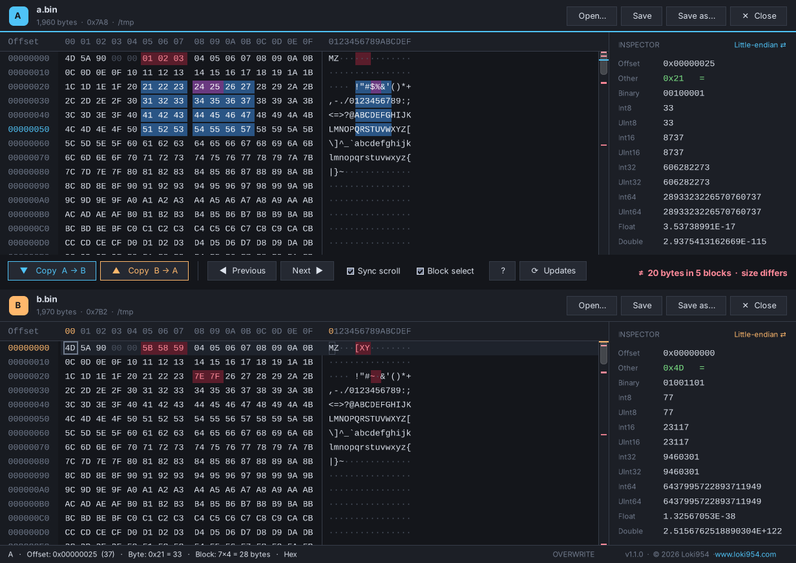

# Hex Editor

A fast, dark-themed, dual-pane **hex editor for Windows** with built-in file comparison.
Open two files, see every differing byte at a glance, and copy bytes from one file to the other with one click.

## Download

**[⬇ HexEditor.exe — latest release](https://github.com/Loki954/HexEditor/releases/latest/download/HexEditor.exe)**

It is a single ~100 KB file with no installer. It runs on Windows 10/11 using the built-in .NET Framework 4.
The program checks for new versions on its own and can update itself.

> On first launch, Windows SmartScreen may warn that the app is unrecognised. Click **More info → Run anyway**.

## Features

- **Two panes (A / B)**: differences are shown in red, and bytes past the end of the shorter file in brown
- **Copy A → B / B → A** copies the selection (or the difference under the cursor) at the same offset
- **Next / previous difference** (F8 / Shift+F8), with a difference map in the scrollbar
- **Synchronised scrolling** of both panes
- **Block (rectangular) selection** by mouse drag; Alt+drag gives a linear selection
- **Direct editing**: type hex (works with any keyboard layout) or text, in insert or overwrite mode
- **Inspector** shows Int8–Int64, Float and Double in LE/BE. Double-click a value to edit it
- **Clipboard**: copy/paste as hex or text, including block copy/paste
- **Find** (Ctrl+F, hex or text), **Go to offset** (Ctrl+G), **Undo/Redo**
- **Open / Save / Save as / Close** for each pane, plus drag & drop
- **Auto-update** from GitHub Releases, verified with SHA-256

## Keyboard shortcuts

| Keys | Action |
|---|---|
| Ctrl+O / Ctrl+S / Ctrl+Shift+S / Ctrl+W | Open / Save / Save as / Close (active pane) |
| F6 | Switch pane A ⇄ B |
| Tab | Switch hex ⇄ text column |
| F8 / Shift+F8 | Next / previous difference |
| Ctrl+Shift+↓ / Ctrl+Shift+↑ | Copy selection A → B / B → A |
| Ctrl+C / Ctrl+X / Ctrl+V | Copy / cut / paste |
| Insert | Toggle insert / overwrite |
| Ctrl+Z / Ctrl+Y | Undo / redo |
| Ctrl+F / F3 | Find / find next |
| Ctrl+G | Go to offset |
| F1 | Help |

Command line: `HexEditor.exe file1 file2`

---

© 2026 **Loki954** · [www.loki954.com](https://www.loki954.com) · All rights reserved.
